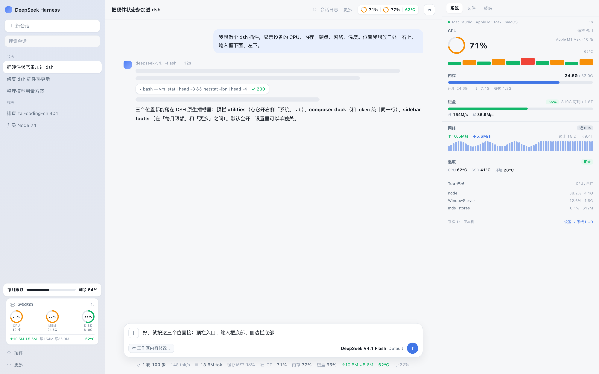
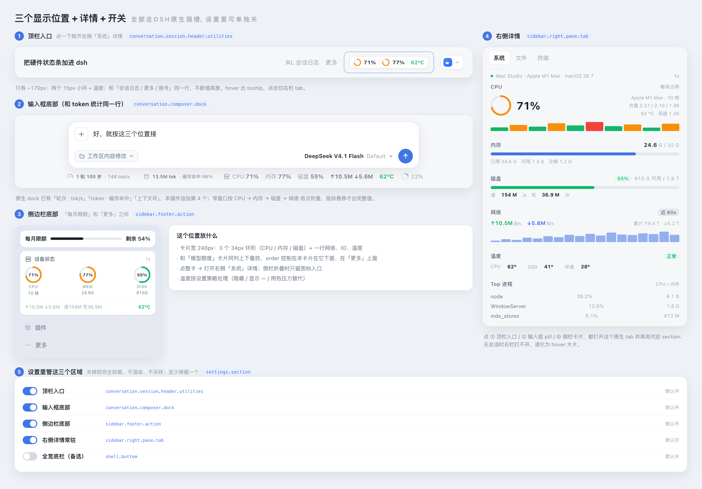
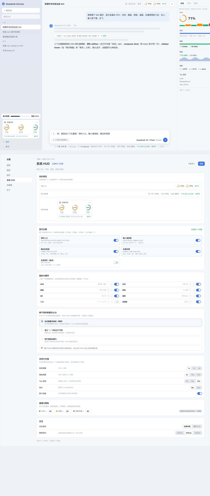

# dsh-system-hud

[](https://www.npmjs.com/package/@ponydev/dsh-system-hud)
[](LICENSE)

**DeepSeek Harness（DSH）Web UI 插件：把本机硬件状态放进界面里三个原生位置。**

- **① 对话顶栏入口**：两个小环 + 温度，和「会话日志 / 更多 / 账号」同一行；点一下打开右侧「系统」详情
- **② 输入框底部**：和 `轮次 · tok/s`、`token · 缓存命中`、上下文环同一行，追加一个原生风格 pill
- **③ 侧边栏底部**：240px 卡片（CPU / 内存 / 磁盘 三个环 + 网络、IO、温度），在「每月限额」和「更多」之间
- **④ 右侧「系统」详情**：原生 tab，每核占用、内存/磁盘明细、60s 网络、温度、Top 进程
- **设置 → 系统 HUD**：三处位置逐个开关、指标开关与排序、拿不到的数据怎么显示、采样周期、阈值

只用**真实数据**：CPU 走进程内 `os.cpus()` 差分，内存/磁盘/网络/IO 走系统命令；macOS 上拿不到温度时按设置策略处理（默认隐藏，绝不填 0）。







## 安装

要求 DSH `>=0.2.0-rc.2 <0.3.0`。

```bash
# CLI
dsh plugin --profile web add @ponydev/dsh-system-hud

# 或在 Web「插件」页搜索安装
```

安装后重启宿主（`launchctl kickstart -k gui/$(id -u)/local.deepseek-harness.web`）并刷新页面。

本地开发：

```bash
dsh plugin --profile web add link:/path/to/dsh-system-hud
```

## 能力与限制

| 指标 | macOS | Linux | 数据来源 |
|---|---|---|---|
| CPU 使用率 / 每核 / 负载 | ✅ | ✅ | 进程内差分，`os.loadavg()` |
| 内存 已用/总量/交换 | ✅ | ✅ | `vm_stat` + `sysctl` / `/proc/meminfo` |
| 磁盘 已用/总量 | ✅ | ✅ | `df -k`（APFS 用 used+free 反算） |
| 磁盘 I/O 读写 | ✅ | ✅ | `ioreg` 累计差分 / `/proc/diskstats` |
| 网络 ↑↓ | ✅ | ✅ | `netstat -ibn` 累计差分 / `/proc/net/dev` |
| 温度 | ❌ 需可选 helper | ✅ | `/sys/class/thermal` |
| Top 进程 | ✅（`ps`） | ✅（`ps`） | 取不到时自动隐藏 |

采样开销：快层（CPU + 网络）实测约 6ms/轮 ≈ 0.6% 单核；内存/磁盘/IO/温度 5s 一次；Top 进程 30s 一次。页面不可见或无位置启用时停止采样。

## 配置

`cordis.patch.yml` 里的默认配置：

```yaml
- insert:
    - id: system-hud
      name: "@ponydev/dsh-system-hud"
      config:
        fastMs: 1000
        slowMs: 5000
        topProcMs: 30000
        regions: { header: true, dock: true, sidebar: true, rightPane: true, bottomBar: false }
```

运行时偏好持久化在 `$DSH_HOME/system-hud/config.json`（0600），由设置页写回；Host 是唯一真相源。

## 开发

```bash
npm run check      # 语法 + i18n 键一致性
npm run smoke      # 离线解析/差分/配置冒烟（不触网）
npm run render     # 离线 UI 预览（有本机 Chrome 时截图到 docs/screenshots/）
```

接口契约见 [`docs/CONTRACT.md`](docs/CONTRACT.md)，设计与取舍见 [`docs/DESIGN.md`](docs/DESIGN.md)，项目规范见 [`AGENTS.md`](AGENTS.md)。

## License

MIT
